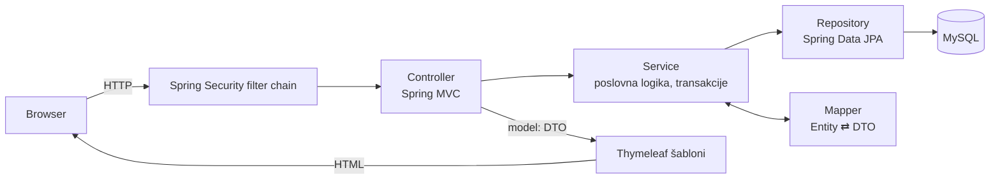
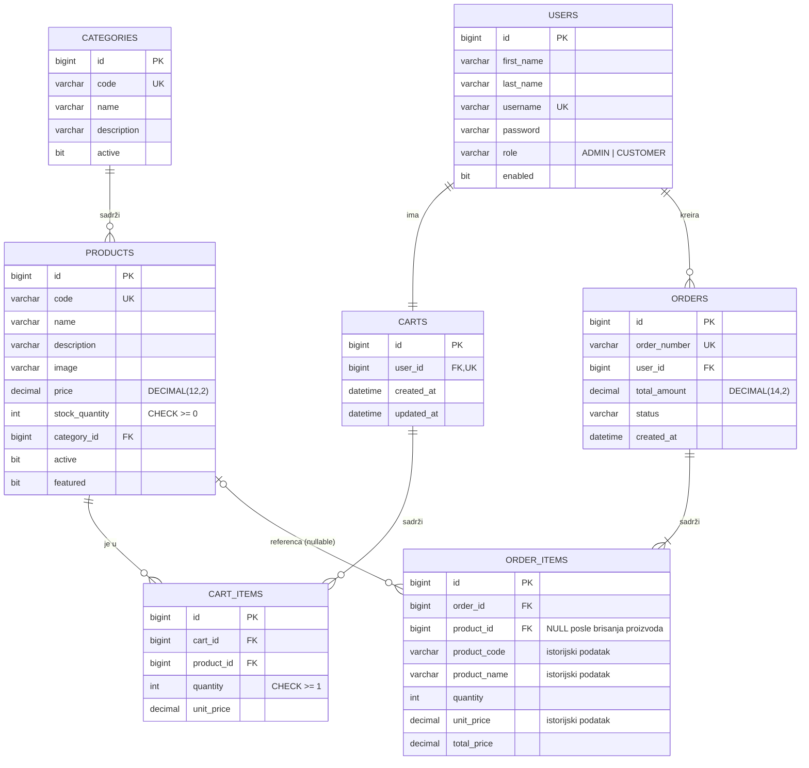
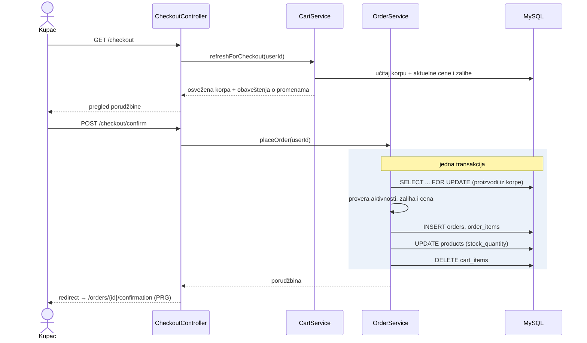

# Arhitektura aplikacije

## 1. Pregled

Aplikacija je monolitna SSR web aplikacija sa slojevitom arhitekturom (Layered Architecture).
Svaki zahtev prolazi kroz iste slojeve:



Pravila između slojeva:

- **Controller** ne pristupa repozitorijumima; radi samo sa servisima i DTO objektima.
- **Service** sadrži svu poslovnu logiku i granice transakcija (`@Transactional`).
- **Entiteti ne izlaze iz servisnog sloja** – šabloni dobijaju DTO objekte
  (`spring.jpa.open-in-view=false`).
- Poslovne greške su izuzeci sa ključem poruke (`BusinessException`), pa tekst ostaje u
  `messages.properties`.

## 2. Struktura Maven projekta

```
webshop/
├── pom.xml
├── README.md
├── docker-compose.yml               # opcioni MySQL za razvoj
├── database/
│   ├── schema.sql                   # kreiranje baze i tabela
│   └── data.sql                     # početni podaci (seed)
├── docs/ARCHITECTURE.md
└── src/
    ├── main/
    │   ├── java/com/example/webshop/
    │   │   ├── WebshopApplication.java
    │   │   ├── config/              # SecurityConfig, WebConfig, ValidationConfig, DataInitializer, Messages
    │   │   ├── controller/          # javni deo, korpa, checkout, porudžbine, profil
    │   │   │   └── admin/           # administrativni kontroleri
    │   │   ├── dto/                 # DTO i form objekti
    │   │   ├── entity/              # JPA entiteti
    │   │   ├── enums/               # Role, OrderStatus
    │   │   ├── exception/           # izuzeci + GlobalExceptionHandler
    │   │   ├── mapper/              # Entity ⇄ DTO
    │   │   ├── repository/          # Spring Data JPA repozitorijumi
    │   │   ├── security/            # UserDetails / UserDetailsService
    │   │   └── service/             # poslovna logika
    │   └── resources/
    │       ├── application.properties
    │       ├── messages.properties  # tekstovi interfejsa (srpski, latinica)
    │       ├── static/{css,js,images}/
    │       └── templates/
    │           ├── index.html, products.html, product-detail.html
    │           ├── fragments/       # layout (head, navbar, footer), komponente
    │           ├── auth/            # prijava, registracija
    │           ├── cart/            # korpa
    │           ├── order/           # checkout, potvrda, istorija, detalji
    │           ├── user/            # profil
    │           ├── admin/           # dashboard, proizvodi, kategorije, korisnici, porudžbine
    │           └── error/           # 403, 404, 4xx, 5xx
    └── test/
        ├── java/com/example/webshop/   # testovi repozitorijuma, servisa, kontrolera, bezbednosti
        └── resources/application.properties   # H2 konfiguracija
```

## 3. ER dijagram



Dodatna ograničenja: `UNIQUE (cart_id, product_id)` na `cart_items` (jedan proizvod jednom u
korpi), indeksi na `products(name, category_id, active)` i `orders(user_id, status, created_at)`.

## 4. Relacije između entiteta (JPA)

| Relacija | Tip | Implementacija |
|---|---|---|
| Category → Product | One-to-Many | `Category.products` (`mappedBy = "category"`) |
| Product → Category | Many-to-One | `Product.category` (`category_id`, obavezno) |
| User → Cart | One-to-One | `Cart.user` (`user_id`, jedinstveno) – vlasnička strana je `Cart` |
| Cart → CartItem | One-to-Many | `Cart.items` (cascade ALL, orphanRemoval) |
| CartItem → Product | Many-to-One | `CartItem.product` |
| User → Order | One-to-Many | `User.orders` / `Order.user` |
| Order → OrderItem | One-to-Many | `Order.items` (cascade ALL) |
| OrderItem → Product | Many-to-One (opciono) | `OrderItem.product` + kopija šifre, naziva i cene |

## 5. Provera konzistentnosti modela – odluke

Pre implementacije model je usklađen sa funkcionalnim zahtevima. Odstupanja i dopune u odnosu
na spisak polja iz specifikacije:

1. **`products.featured`** – dodato polje. Specifikacija traži „izdvojene proizvode“ na početnoj
   strani, a model nije imao podatak po kome bi se oni birali.
2. **User ↔ Cart** – relacija je jednosmerna na JPA nivou (`Cart.user`). Inverzna strana
   (`User.cart`) je namerno izostavljena jer bi Hibernate pri svakom učitavanju korisnika
   izvršavao dodatni upit. Korpa se kreira zajedno sa korisnikom.
3. **`order_items.product_id` je nullable** – da bi proizvod mogao fizički da se obriše, a
   porudžbina ostala ispravna (šifra, naziv i cena su sačuvani u samoj stavci).
4. **Uloge i statusi** se čuvaju kao `VARCHAR` (čitljivo, bezbedno pri dodavanju novih vrednosti).
5. **Kategorija sa proizvodima** ne može da se obriše, samo deaktivira. Proizvodi neaktivne
   kategorije nisu vidljivi u javnom delu.

## 6. Glavne funkcionalnosti

| Celina | Funkcionalnosti |
|---|---|
| Javni deo | početna (kategorije, izdvojeni i najnoviji proizvodi), katalog sa karticama, filter po kategoriji, pretraga po nazivu i šifri, paginacija, detalji proizvoda |
| Nalog | registracija (uvek CUSTOMER), prijava/odjava, profil, izmena podataka, promena lozinke |
| Korpa | dodavanje, izmena količine, uklanjanje, iznosi po stavci i ukupno, provera zaliha, broj artikala u navigaciji |
| Kupovina | pregled porudžbine uz ponovnu proveru cena i zaliha, potvrda, stranica sa potvrdom |
| Porudžbine | istorija i detalji sopstvenih porudžbina |
| Administracija | dashboard; proizvodi (CRUD, slike, cene, zalihe, aktivacija); kategorije; korisnici (uloge, aktivacija, zaštita poslednjeg ADMIN-a); porudžbine (pretraga, filteri, promena statusa) |

## 7. Tok kreiranja porudžbine



Ako bilo koja provera ne prođe (nema dovoljno zaliha, cena se promenila nakon pregleda, proizvod
je deaktiviran), baca se izuzetak, transakcija se poništava (rollback) i kupac se vraća na pregled
porudžbine sa objašnjenjem.

Statusi porudžbine: `PENDING → CONFIRMED → PROCESSING → SHIPPED → COMPLETED`, uz mogućnost
`CANCELLED`. `COMPLETED` i `CANCELLED` su konačni; otkazivanje vraća količine na stanje.

## 8. Pravila pristupa

| Putanja | Pristup |
|---|---|
| `/`, `/products/**`, `/login`, `/register`, statički resursi | svi |
| `/cart/**`, `/checkout/**`, `/orders/**`, `/profile/**` | prijavljeni korisnici (samo sopstveni podaci) |
| `/admin/**` | samo `ROLE_ADMIN` (URL pravilo + `@PreAuthorize` na kontrolerima) |
